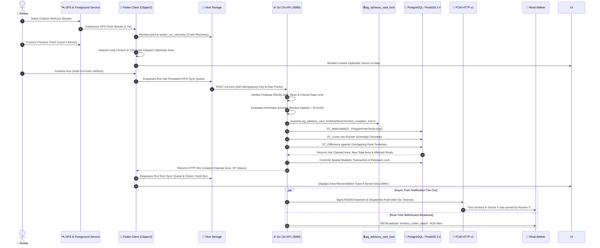
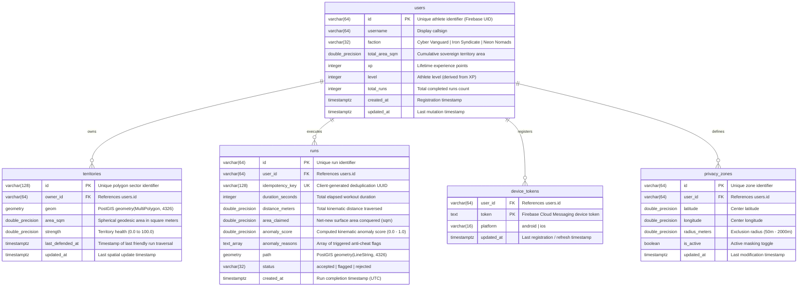

# 🏃 Territory Runner — Server-Authoritative Real-Time GPS Territory Capture

<div align="center">

```
  _______             _ _                     _____                                 
 |__   __|           (_) |                   |  __ \                                
    | | ___ _ __ _ __ _| |_ ___  _ __ _   _  | |__) |   _ _ __  _ __   ___ _ __     
    | |/ _ \ '__| '__| | __/ _ \| '__| | | | |  _  / | | | '_ \| '_ \ / _ \ '__|    
    | |  __/ |  | |  | | || (_) | |  | |_| | | | \ \ |_| | | | | | | |  __/ |       
    |_|\___|_|  |_|  |_|\__\___/|_|   \__, | |_|  \_\__,_|_| |_|_| |_|\___|_|       
                                       __/ |                                        
                                      |___/                                         
```

**Real-Time Server-Authoritative Location-Based Athletic Fitness Platform**  
*Enclose arbitrary closed-loop GPS territory polygons on a calm, high-contrast tactical map. Defend land from rivals, climb weekly competitive league tiers, and receive tactical AI coaching.*

<br>

[](https://github.com/Ayush-00-hui/Territory-Runner-Game/actions/workflows/ci.yml)
[](test/)
[](backend/)
[](lib/)
[](lib/)
[](LICENSE)

<br>

[](https://flutter.dev/)
[](https://dart.dev/)
[](https://go.dev/)
[](https://postgis.net/)
[](backend/Dockerfile)
[](backend/internal/auth/)
[](backend/internal/notify/)
[](backend/internal/coach/)

<br>

[Overview](#-executive-overview) • [Why Territory Runner?](#-why-territory-runner) • [Architecture](#-system-architecture) • [Core Mechanics](#-core-mechanics--algorithmic-parity) • [Design System](#-athletic-minimal-design-system-ink--pacer-blue) • [Quickstart](#-getting-started--local-development) • [API Reference](#-rest--websocket-api-reference) • [Verification](#-test-suite--quality-verification) • [Contributing](#-contributing--license)

</div>

---

## 📑 Table of Contents
- [Executive Overview](#-executive-overview)
- [Why Territory Runner? (Comparative Analysis)](#-why-territory-runner-comparative-analysis)
- [System Architecture](#-system-architecture)
  - [1. Component Architecture](#1-end-to-end-component-architecture)
  - [2. Run Conquest Lifecycle Sequence](#2-run-conquest-lifecycle-sequence-diagram)
  - [3. Spatial Database Entity Relationship](#3-spatial-database-entity-relationship-diagram)
- [Core Mechanics & Algorithmic Parity](#-core-mechanics--algorithmic-parity)
  - [1. Multi-Candidate Proximity & Lasso Closure](#1-multi-candidate-proximity--lasso-closure)
  - [2. Geodesic Shoelace Area Calculation](#2-geodesic-shoelace-area-calculation)
  - [3. Transaction-Scoped Spatial Concurrency](#3-transaction-scoped-spatial-concurrency)
  - [4. Territory Decay & Friendly Defense](#4-territory-decay--friendly-defense)
  - [5. Kinematic Anti-Cheat & Speed Ceilings](#5-kinematic-anti-cheat--speed-ceilings)
  - [6. Dual-Layer Privacy Zones & WebSocket Radar](#6-dual-layer-privacy-zones--websocket-radar)
  - [7. Social Duels & Anti-Abuse Integrity](#7-social-duels--anti-abuse-integrity)
  - [8. Explore Claim Planner & Net-New Area Deduction](#8-explore-claim-planner--net-new-area-deduction)
  - [9. Donut Hole Ray-Casting Classification](#9-donut-hole-ray-casting-classification)
- [Athletic Minimal Design System (Ink + Pacer Blue)](#-athletic-minimal-design-system-ink--pacer-blue)
  - [1. Philosophy & Color Tokens](#1-philosophy--color-tokens)
  - [2. Typography & Zero Raster Fallback](#2-typography--zero-raster-fallback)
  - [3. Dynamic Collision-Free HUD Tracking](#3-dynamic-collision-free-hud-tracking)
  - [4. Unified Notifications (AppToast)](#4-unified-notifications-apptoast)
- [Weekly Competitive League Engine](#-weekly-competitive-league-engine)
- [Push Notification Infrastructure (FCM HTTP v1)](#-push-notification-infrastructure-fcm-http-v1)
- [Getting Started & Local Development](#-getting-started--local-development)
  - [Prerequisites](#prerequisites)
  - [Option A: Full Stack with Docker Compose](#option-a-full-stack-with-docker-compose-recommended)
  - [Option B: Hermetic In-Memory Dev Store](#option-b-backend-with-hermetic-in-memory-dev-store)
  - [Running the Flutter Mobile Client](#running-the-flutter-mobile-client)
- [REST & WebSocket API Reference](#-rest--websocket-api-reference)
- [Test Suite & Quality Verification](#-test-suite--quality-verification)
- [Troubleshooting & FAQ](#-troubleshooting--faq)
- [Contributing & License](#-contributing--license)

---

## 🌟 Executive Overview

Traditional fitness trackers record passive linear polylines. **Territory Runner** transforms physical outdoor runs into an engaging, server-authoritative spatial strategy platform:

```
🏃 Athlete Runs Closed Loop ──► 🛰️ Kinematic Filter ──► 📐 Shoelace Area Metric
                                                                │
🏆 PostGIS Authority ◄── ☁️ Offline Sync Queue ◄── ✂️ Clipper2 Optimistic Preview
```

- 🟢 **No Rigid Grids:** Claim arbitrary organic loop polygons around city blocks, parks, or running tracks without being locked to S2 or H3 hexagonal grids.
- 📐 **Dual-Engine Geometric Parity:** Client-side Dart engine (Clipper2) and server-side Go engine (PostGIS) share identical thresholds and 7 golden fixtures to guarantee $<0.5\%$ area discrepancy.
- 🛡️ **Server-Authoritative Conquest:** Runs are validated and committed inside transaction-scoped PostgreSQL advisory locks (`pg_advisory_xact_lock`) to guarantee atomic, concurrent, race-free spatial mutations.
- 🔋 **Screen-Lock Background Tracking:** Foreground location service with sticky notifications and CPU wake locks (`wakelock_plus`) ensures unthrottled tracking while running with screen locked.
- 💾 **Crash Recovery Safety Box:** Waypoints flush continuously to Hive storage (`active_run_recovery`); unexpected OS terminations prompt seamless session restoration upon relaunch.
- ⚡ **Offline-First Resilience:** Local Clipper2 generates instant optimistic previews. Runs queue in persistent FIFO Hive boxes and sync with server reconciliation alerts upon reconnection.
- 🎨 **Ink + Pacer Blue Aesthetic:** Deep carbon canvas (`#090B0F`), dark elevated slate (`#12151B`), and crisp Pacer Blue (`#4C8DFF`) with coral rival indicators (`#FF7A59`) for high sunlight readability and zero visual clutter.
- 📲 **Modern FCM HTTP v1 Alerts:** Asynchronous, non-blocking rival conquest push alerts powered by server-side Google OAuth2 RS256 JWT assertion signing.
- 🏅 **Weekly Competitive League:** Monday 00:00:00 UTC automated weekly resets categorizing athletes into dynamic Diamond (top 5%), Gold (next 20%), Silver (next 35%), and Bronze (bottom 40%) percentile divisions.

---

## 💡 Why Territory Runner? (Comparative Analysis)

| Feature | Standard Trackers (Strava, Nike) | Grid GPS Games (Ingress, Turf) | Territory Runner |
| :--- | :--- | :--- | :--- |
| **Spatial Model** | Passive 1D polylines (no territory concept) | Rigid discrete cells (S2 / H3 hex grids) | **Continuous arbitrary organic 2D polygons** |
| **Enclosure Mechanism** | None | Fixed geographic portal linking | **Real-time proximity & lasso self-intersection snap** |
| **Concurrency Control** | Independent runs, no conflict | Optimistic locks with retry aborts | **Transaction-scoped PostGIS advisory lock (`pg_advisory_xact_lock`)** |
| **Offline Capability** | Records track, no gameplay | Fails without active cell signal | **Dual-engine: local Clipper2 optimistic preview + Hive FIFO queue** |
| **Screen Lock GPS** | Standard OS background tracking | Often throttled by OS battery management | **Hardened foreground service with sticky notification & wakelock** |
| **Anti-Cheat Validation** | Post-hoc manual flag reviews | Basic speed thresholds | **Kinematic filter with activity-specific speed ceilings (running: 25 km/h, walking: 10 km/h, cycling: 50 km/h)** |
| **Privacy Safeguards** | Client-only map blur | None | **Dual-layer: client redaction + server-side geodesic suppression in WebSockets & exports** |
| **Rival Alerts** | None | Delayed batch emails | **Real-time WebSocket alerts + FCM HTTP v1 background push** |
| **Visual Aesthetic** | Cluttered social feed | Neon, gamified arcade glare | **Calm, high-contrast Ink + Pacer Blue (`#090B0F`, `#4C8DFF`)** |

---

## 🏗️ System Architecture

### 1. End-to-End Component Architecture


---

### 2. Run Conquest Lifecycle (Sequence Diagram)



---

### 3. Spatial Database Entity Relationship Diagram



---

## 🧮 Core Mechanics & Algorithmic Parity

### 1. Multi-Candidate Proximity & Lasso Closure

```
                       Start Point (A)
                             ▲
                             │
            ┌────────────────┴────────────────┐
            │                                 │
            │          CLOSED LOOP            │
            │                                 │
            ▼                                 │
    Intersection (P_int) ◄────────────────────┘
            │
            ▼ Trailing Path (Continues running)
```

1. **Self-Intersection Detection:** When current segment $\overline{P_{n-1}P_n}$ intersects an earlier segment $\overline{P_j P_{j+1}}$, the intersection point $\mathbf{P}_{\text{int}}$ is calculated via 2D cross-product line determinants:
   $$t = \frac{(x_1 - x_3)(y_3 - y_4) - (y_1 - y_3)(x_3 - x_4)}{(x_1 - x_2)(y_3 - y_4) - (y_1 - y_2)(x_3 - x_4)}$$
2. **Lasso Snap & Tail Retention:** The closed loop is formed from $[\mathbf{P}_{\text{int}}, P_{j+1}, \dots, P_{n-1}, \mathbf{P}_{\text{int}}]$. Preceding breadcrumbs prior to $P_j$ are preserved as the tail, ensuring continuous athletic movement without resetting the run session.
3. **Multi-Candidate Search:** If direct intersection is missing, proximity search scans vertices within $35\text{ m}$ to select the optimal non-self-intersecting candidate.

---

### 2. Geodesic Shoelace Area Calculation

Planar Shoelace formulas fail on spherical earth coordinates. Territory Runner projects spherical coordinates into an equidistant azimuthal tangent plane centered at the polygon's centroid:

$$x_i = R \cdot (\lambda_i - \lambda_0) \cdot \cos\left(\frac{\phi_i + \phi_0}{2}\right), \quad y_i = R \cdot (\phi_i - \phi_0)$$

$$\text{Area} = \frac{1}{2} \left| \sum_{i=0}^{n-1} (x_i y_{i+1} - x_{i+1} y_i) \right|$$

- **Accuracy:** Tested against 7 shared golden fixtures; Dart Clipper2 and Go PostGIS agree within $<0.5\%$ error margin across small city blocks ($5,000\text{ m}^2$) and large park perimeters ($100,000\text{ m}^2$).

---

### 3. Transaction-Scoped Spatial Concurrency

To prevent race conditions during concurrent runs in overlapping territories, the Go backend enforces PostgreSQL advisory locking:

```sql
-- 1. Acquire transaction-scoped lock (releases automatically on COMMIT or ROLLBACK)
SELECT pg_advisory_xact_lock(hashtext('territory_mutation_lock'));

-- 2. Validate and clean submitted loop
WITH valid_loop AS (
    SELECT ST_MakeValid(ST_SetSRID(ST_GeomFromText($1), 4326)) AS geom
),
-- 3. Cut overlapping rival territories
rival_cuts AS (
    UPDATE territories t
    SET geom = ST_Difference(t.geom, vl.geom),
        area_sqm = ST_Area(ST_Difference(t.geom, vl.geom)::geography),
        updated_at = NOW()
    FROM valid_loop vl
    WHERE t.owner_id != $2 AND ST_Intersects(t.geom, vl.geom)
    RETURNING t.id, t.owner_id, t.area_sqm
)
-- 4. Union into runner's sovereign geometry
INSERT INTO territories (id, owner_id, geom, area_sqm, strength, updated_at)
VALUES ($3, $2, (SELECT geom FROM valid_loop), (SELECT ST_Area(geom::geography) FROM valid_loop), 100.0, NOW())
ON CONFLICT (owner_id) DO UPDATE
SET geom = ST_Union(territories.geom, EXCLUDED.geom),
    area_sqm = ST_Area(ST_Union(territories.geom, EXCLUDED.geom)::geography),
    updated_at = NOW();
```

---

### 4. Territory Decay & Friendly Defense

```
100% Strength ──[ -15% / day without run ]──► 30% Vulnerable ──► <50m² Collapse
     ▲                                                │
     └──────── Friendly Athlete Runs Through ─────────┘
```

- **Health Scale:** Captured territory starts at $100.0\%$ strength.
- **Decay Rate:** Decays at $-15.0\%$ per day without friendly traversal.
- **Defense Mechanism:** When the owner runs through their own land, `last_defended_at` is renewed, restoring strength to $100.0\%$.
- **Rival Bonus:** Attacking a territory below $30\%$ strength awards a $1.5\times$ XP bonus to the rival. Contested fragments under $50\text{ m}^2$ collapse automatically.

---

### 5. Kinematic Anti-Cheat & Speed Ceilings

Every run submission is analyzed by the kinematic validation pipeline before hitting PostGIS:

| Metric | Running | Walking | Cycling | Action on Violation |
| :--- | :--- | :--- | :--- | :--- |
| **Instant Max Speed** | $25.0\text{ km/h}$ | $10.0\text{ km/h}$ | $50.0\text{ km/h}$ | Immediate Anomaly Score $+40$ |
| **Sustained Avg Speed**| $22.0\text{ km/h}$ | $8.5\text{ km/h}$ | $40.0\text{ km/h}$ | Immediate Anomaly Score $+30$ |
| **Max Acceleration** | $4.0\text{ m/s}^2$ | $2.5\text{ m/s}^2$ | $6.0\text{ m/s}^2$ | Teleport Flag |
| **Jitter Variance** | $>15\text{ m}$ jump | $>10\text{ m}$ jump | $>25\text{ m}$ jump | Segment Splitting |

- **Score $\ge 55$:** Run is rejected with `422 Unprocessable Entity` (`ANOMALY_REJECTED`). Submitting cycling speeds under running is rejected immediately.
- **Score $30 - 54$:** Run is marked `flagged` for administrative review.
- **Score $< 30$:** Run is approved (`accepted`).

---

### 6. Dual-Layer Privacy Zones & WebSocket Radar

```
[ Private Zone (Radius 200m) ] ──► Coordinates Masked in DB & GPX Export
              │
              └──► WebSocket Hub actively suppresses presence on rival radar
```

1. **Client-Side Masking:** Athletes define circular privacy zones ($50\text{ m} - 2,000\text{ m}$) centered around home or office.
2. **Server Geodesic Suppression (`backend/internal/ws/hub.go`):** When an athlete runs within their active privacy zone, the server suppresses broadcast packets to rival clients.
3. **Export Redaction:** Public GPX 1.1 and GeoJSON exports redact all waypoints inside privacy boundaries.

---

### 7. Social Duels & Anti-Abuse Integrity

- **Canonical Symmetric Unique Index:**
  ```sql
  CREATE UNIQUE INDEX uq_duels_active_pair 
  ON duels (LEAST(challenger_id, opponent_id), GREATEST(challenger_id, opponent_id))
  WHERE status IN ('pending', 'active');
  ```
  Guarantees that no two athletes can have more than one concurrent active or pending challenge.
- **Guardrails:** Self-challenges are blocked at the database level (`chk_duels_no_self`). XP stakes are bounded $[0, 1000]$, area targets $[500, 500000]\text{ m}^2$, and distance $[0.5, 50.0]\text{ km}$.
- **Automatic Expiration:** Duels exceeding 24 hours are evaluated and resolved automatically by the server.

---

### 8. Explore Claim Planner & Net-New Area Deduction

- Presets ($2\text{k}, 5\text{k}, 10\text{k}, 25\text{k}\text{ m}^2$) and interactive sliders synthesize real pedestrian routes via OSRM.
- **Clipper2 Net-New Deduction:** Computes optimistic net-new territory area by subtracting already-owned polygons before the athlete takes their first stride.

---

### 9. Donut Hole Ray-Casting Classification

- When runners circle a block containing an unclaimable interior or rival island, ray-casting containment depth classification populates FlutterMap's `holePointsList`.
- Interior islands render as true transparent cutouts rather than solid fills.

---

## 🎨 Athletic Minimal Design System (Ink + Pacer Blue)

Built exclusively for outdoor athletic performance, direct sunlight readability, OLED battery conservation, and thumb-driven one-handed operation.

```
┌────────────────────────────────────────────────────────┐
│                        AppColors                       │
├────────────┬────────────┬─────────────┬────────────────┤
│   bgDeep   │  surface   │   accent    │     rival      │
│  #090B0F   │  #12151B   │   #4C8DFF   │    #FF7A59     │
└────────────┴────────────┴─────────────┴────────────────┘
```

### 1. Philosophy & Color Tokens

- **Dark-Only Surface Hierarchy:**
  - `bgDeep` (`#090B0F`): Deepest OLED black canvas.
  - `surface` (`#12151B`): Primary card, bottom sheet, and navigation surface.
  - `surface2` (`#1C222D`): Secondary nested containers and inactive chips.
  - `borderSubtle` (`#FFFFFF @ 8%`): Clean 1px hairline dividers.
- **Accents:**
  - `accent` (`#4C8DFF`): Pacer Blue — single focal primary action and friendly territory fill.
  - `rival` (`#FF7A59`): Coral — rival territories, contested boundaries, and threat indicators.
  - `success` (`#4FD1A5`): Emerald — loop closure confirmation and milestone badges.
- **Zero Raw Colors Policy:** Verified by automated CI regression test (`no_raw_colors_test.dart`); zero arbitrary `Color(0x` or `Colors.*` exist in UI code.

---

### 2. Typography & Zero Raster Fallback

- **Bundled Fonts Only:** Only `Inter-Regular.ttf` (400), `Inter-SemiBold.ttf` (600), and `Inter-Bold.ttf` (700) are bundled.
- **Weight Mapping:** All unbundled weights (`w500`, `w800`, `w900`) were eliminated and mapped to 400/600/700 to prevent synthetic raster fallback and blurred text on high-DPI Android displays.
- **Tabular Figures:** All numeric displays (pace, distance, timer, area, splits, rank) enforce `FontFeature.tabularFigures()` via `AppText` tokens, guaranteeing zero horizontal digit jitter during movement.

---

### 3. Dynamic Collision-Free HUD Tracking

```
┌────────────────────────────────────────────────────────┐
│                   MAP CONTROLS RAIL                    │
│   [Recenter]  [Plan Route]  [Goal]  [More Tools]       │
└────────────────────────────────────────────────────────┘
                           │ (pad.bottom + 12 + hudHeight + 12)
┌────────────────────────────────────────────────────────┐
│                   RUN HUD (MEASURED)                   │
│   Pace: 5'12"    │    Distance: 3.42 km    │  18:42    │
└────────────────────────────────────────────────────────┘
```

- Floating map controls (`MapControlsRail`, `SosShieldButton`) are wrapped in `MeasureSize` listeners.
- Bottom offsets dynamically calculate as `pad.bottom + 12 + hudHeight + 12`, eliminating all hardcoded magic numbers (`175`, `230`) and preventing interactive overlay collisions.

---

### 4. Unified Notifications (`AppToast`)

- Replaced 100% of raw Material `SnackBar` call sites with canonical `AppToast.show()` floating obsidian pills.
- Always pairs colored status indicators with standard Material icons and calm sentence-case athletic copy.
- Enforced by automated CI regression test in `design_system_test.dart`.

---

## 🏅 Weekly Competitive League Engine

- **Canonical Time Standard:** All weekly resets execute at Monday 00:00:00 UTC:
  $$\text{ResetTimestamp} = \text{date\_trunc}('week', \text{NOW}() \text{ AT TIME ZONE } 'UTC') + 7\text{ days}$$
  Immune to client timezone tampering.
- **Dynamic Percentile Divisions:** Athletes are tiered dynamically based on percentile rankings:
  - 💎 **Diamond:** Top 5% of active athletes.
  - 🥇 **Gold:** Next 20% (Percentile 75% to 95%).
  - 🥈 **Silver:** Next 35% (Percentile 40% to 75%).
  - 🥉 **Bronze:** Bottom 40% (Percentile 0% to 40%).

---

## 📲 Push Notification Infrastructure (FCM HTTP v1)

- **Pure Go OAuth2 RS256 Client:** Implemented using Go standard library (`crypto/rsa`, `crypto/sha256`) in [`backend/internal/notify/fcm.go`](backend/internal/notify/fcm.go) without bulky GCP SDK dependencies.
- **Asynchronous Non-Blocking Fan-Out:** Push dispatches execute in detached goroutines (`5s` timeout), guaranteeing that API run submissions return `HTTP 201 Created` in $<50\text{ ms}$ without push network latency.
- **Graceful Fallback:** Operates as a safe no-op with warning logs when service account credentials are not provided in local dev mode.

---

## 🚀 Getting Started & Local Development

### Prerequisites

| Tool | Version Requirement | Purpose |
| :--- | :--- | :--- |
| **Go** | 1.22+ (tested on 1.24) | Backend compilation and test execution |
| **Flutter SDK** | 3.13+ (Dart 3.0+) | Cross-platform mobile client |
| **Docker & Docker Compose** | v2.20+ | Multi-stage build & PostGIS spatial database |
| **Android SDK / Xcode** | Android 13+ / iOS 15+ | Mobile deployment target |

---

### Option A: Full Stack with Docker Compose (Recommended)

1. **Clone Repository:**
   ```bash
   git clone https://github.com/Ayush-00-hui/Territory-Runner-Game.git
   cd Territory-Runner-Game
   ```

2. **Launch PostgreSQL 16 + PostGIS 3.4 & Server:**
   ```bash
   cd backend
   docker compose up -d
   ```
   The backend starts at `http://localhost:8080` with PostGIS listening on port `5432`.

3. **Verify Database Migrations:**
   ```bash
   # Run migrations using the built-in Go migration runner
   go run cmd/server/main.go
   ```

---

### Option B: Backend with Hermetic In-Memory Dev Store

To develop on the backend without Docker or PostgreSQL:

```bash
cd backend
export ENV=development
export AUTH_MODE=dev
go run cmd/server/main.go
```
The server automatically initializes an in-memory spatial store with full API capabilities.

---

### Running the Flutter Mobile Client

1. **Install Dependencies:**
   ```bash
   flutter pub get
   ```

2. **Run Analysis & Tests:**
   ```bash
   flutter analyze
   flutter test
   ```

3. **Launch Mobile App:**
   ```bash
   # Android Device or Emulator
   flutter run -d emulator-5554

   # Windows Desktop (for rapid layout & UI debugging)
   flutter run -d windows
   ```

> **Note for Android Emulators:**  
> Android emulators route `localhost` to the emulator loopback. Run `adb reverse tcp:8080 tcp:8080` so the emulator reaches your local backend.

---

## 📡 REST & WebSocket API Reference

### Core Endpoints

| Method | Endpoint | Description | Auth Required |
| :--- | :--- | :--- | :--- |
| `POST` | `/v1/runs` | Submit completed run with coordinates | Yes (Bearer JWT) |
| `GET` | `/v1/territories` | Fetch territories within bounding box (`minLat`, `maxLat`, `minLng`, `maxLng`) | No |
| `GET` | `/v1/me/profile` | Retrieve athlete profile and XP stats | Yes |
| `PUT` | `/v1/me/faction` | Update athlete faction allegiance | Yes |
| `GET` | `/v1/factions/standings`| Global faction surface dominance | No |
| `GET` | `/v1/leaderboard` | Top athlete leaderboard ranking | No |
| `GET` | `/v1/me/privacy-zones`| List athlete privacy exclusion zones | Yes |
| `PUT` | `/v1/me/privacy-zones`| Save or replace privacy exclusion zones | Yes |
| `GET` | `/v1/friends` | List squad friends and pending requests | Yes |
| `POST` | `/v1/friends/request` | Send friend request by callsign | Yes |
| `GET` | `/v1/duels` | List active, pending, and past duels | Yes |
| `POST` | `/v1/duels` | Issue 24-hour head-to-head duel challenge | Yes |
| `POST` | `/v1/device-token` | Register FCM push notification token | Yes |
| `POST` | `/v1/coach/debrief` | Generate post-run AI coaching analysis | Yes |
| `GET` | `/v1/ws` | Real-time WebSocket connection | Yes (JWT query/header) |

---

### WebSocket Frame Protocol

Connected clients stream real-time events at `/v1/ws`:

```json
// Client -> Server: Presence Heartbeat (1 Hz)
{
  "type": "presence",
  "payload": {
    "latitude": 37.7749,
    "longitude": -122.4194,
    "speed": 3.4,
    "heading": 85.0
  }
}

// Server -> Client: Rival Movement Broadcast
{
  "type": "runner_presence",
  "payload": {
    "user_id": "rival_uuid",
    "username": "Phantom_Vanguard",
    "faction": "Iron Syndicate",
    "position": { "latitude": 37.7752, "longitude": -122.4198 },
    "speed": 3.8,
    "heading": 92.0
  }
}

// Server -> Client: Targeted Attack Alert
{
  "type": "territory_under_attack",
  "payload": {
    "territory_id": "sector_42",
    "message": "Rival ShadowRunner captured 3,500 m² of your territory"
  }
}
```

---

## 🧪 Test Suite & Quality Verification

Territory Runner enforces strict automated testing across both client and server:

```
┌────────────────────────────────────────────────────────┐
│                 TEST VERIFICATION SUITE                │
├─────────────────────────┬──────────────┬───────────────┤
│ Domain                  │ Test Count   │ Status        │
├─────────────────────────┼──────────────┼───────────────┤
│ Flutter Client (lib/)   │ 317 tests    │ 51 / 51 PASS  │
│ Go Backend (backend/)   │ 79 tests     │ 12 / 12 PASS  │
│ Shared Golden Parity    │ 7 fixtures   │ <0.5% diff    │
│ Static Code Analysis    │ 0 issues     │ CLEAN         │
│ Code Formatting         │ 164 files    │ 100% CLEAN    │
└─────────────────────────┴──────────────┴───────────────┘
```

```bash
# 1. Run Flutter Static Analysis
flutter analyze

# 2. Run All 51 Flutter Test Suites
flutter test

# 3. Run Design System & Accessibility Audits
flutter test test/theme/no_raw_colors_test.dart
flutter test test/theme/wcag_contrast_test.dart
flutter test test/theme/accessibility_test.dart
flutter test test/u6_polish_and_proof_test.dart
flutter test test/design_system_test.dart

# 4. Run Go Backend Tests
cd backend
go test -v ./...
```

---

## ❓ Troubleshooting & FAQ

#### Q: GPS tracking drops points when the phone screen is turned off.
**A**: Ensure location permissions are set to "Allow all the time". Territory Runner runs an Android foreground service with a persistent sticky notification (`FOREGROUND_SERVICE_LOCATION`) and holds a CPU wake lock (`wakelock_plus`) to prevent OS battery management from sleeping the GPS chip.

#### Q: The Flutter client cannot connect to `http://localhost:8080` on an Android Emulator.
**A**: Android emulators route `localhost` to the emulator loopback, not the host machine. Run:
```bash
adb reverse tcp:8080 tcp:8080
```
Or set `API_BASE_URL=http://10.0.2.2:8080` in the client environment.

#### Q: Why does the Go server report `database connection refused`?
**A**: Ensure PostgreSQL with PostGIS is running (`docker compose up -d`). If developing without PostgreSQL, start the server with `ENV=development` and omit `DATABASE_URL`; it will fall back to the hermetic in-memory store.

#### Q: How do I configure Google Gemini API for post-run coaching?
**A**: Set `GEMINI_API_KEY=AIzaSy...` in your backend `.env` file. If omitted, the server automatically uses an on-device sports physiology heuristic rule engine.

---

## 🤝 Contributing & License

Contributions are welcome! Please open an issue or pull request.  
This project is licensed under the MIT License — see the [LICENSE](LICENSE) file for details.

<div align="center">
  <sub>🏃 Territory Runner • Server-Authoritative Real-Time GPS Territory Capture • Flutter + Go PostGIS</sub>
</div>
