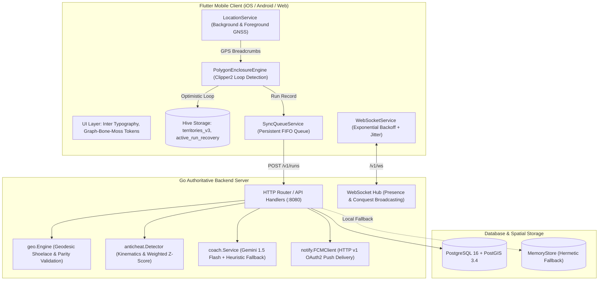

# Territory Runner — Engineering & Product Improvement Audit (Phase 0)

> **Document Status**: Authoritative Baseline  
> **Date**: October 2026  
> **Branch**: `fix-ws-reconnect`  
> **Audit Lead**: Principal Software & Systems Engineer  

---

## 1. Executive Summary & Verification Baseline

A complete, evidence-based repository audit was conducted across the **Territory Runner** codebase to establish ground-truth behavior, verify static analysis and test baselines, map system architecture, trace data flows, and identify concrete defects, release blockers, and optimization opportunities.

### 1.1 Baseline Test & Static Analysis Execution
All commands were executed in the active host environment (Windows 11, Flutter 3.47.3, Dart 3.13.3, Go 1.27.0, Python 3.14.6):

| Component | Target / Command | Exit Code | Real Result |
| :--- | :--- | :---: | :--- |
| **Flutter Static Analysis** | `flutter analyze` | `0` | **0 issues found** (clean in 60.1s) |
| **Flutter Test Suite** | `flutter test` | `0` | **378 passed, 0 failed** across 51 test suites |
| **Go Static Analysis** | `go vet ./...` (in `backend/`) | `0` | **0 issues found** (clean exit) |
| **Go Test Suite** | `go test -v -count=1 ./...` | `0` | **130 passed, 0 failed** across 10 packages |

```
Verified Test Baseline:
  • Flutter Unit & Widget Tests: 378 passing
  • Go Unit & Integration Tests: 130 passing
  • Combined Suite: 508 verified passing tests
```

---

## 2. System Architecture & Entry Points



### 2.1 Actual Entry Points
- **Flutter Application**: [lib/main.dart](file:///c:/Users/AYUSH/Desktop/territory_runner/lib/main.dart#L23-L98)
  - Configures `runZonedGuarded`, system edge-to-edge UI, `AppLogger`, global `ErrorWidget.builder` (`CalmErrorScreen`), and `PlatformDispatcher.onError`.
  - Initializes Hive boxes (`territories_v3`, `profile`, `active_run_recovery`).
  - Calls `runApp(const TerritoryApp())` immediately to eliminate splash screen latency.
  - Initializes Firebase and notification services asynchronously in background (`_initServicesAsync()`).
- **Go Backend Server**: [backend/cmd/server/main.go](file:///c:/Users/AYUSH/Desktop/territory_runner/backend/cmd/server/main.go#L24-L168)
  - Healthcheck handler via CLI flag `healthcheck` querying `/healthz`.
  - Structured JSON logging via `log/slog`.
  - Environment configuration loader (`config.Load()`).
  - Automated database migration runner using PostgreSQL advisory lock (`migrations.Run`).
  - Store initialization: `store.NewPostgresStore` with automatic graceful fallback to `store.NewMemoryStore` for local development without Docker.
  - Asynchronous workers: WebSocket Hub (`wsHub.Run()`) and hourly territory decay ticker (`dataStore.ApplyTerritoryDecay`).

---

## 3. End-to-End Run-to-Territory Workflow

```
[1. User Taps Start] ──> LocationService acquires GPS Stream (1Hz)
          │
[2. Breadcrumbs Ingested] ──> PolygonEnclosureEngine filters stationary jitter (<1.8m)
          │                   and outlier speed jumps (>35km/h running)
          │
[3. Loop Closed] ───────────> Proximity (<35m to origin) or Lasso Intersection detected
          │                   Geodesic shoelace computes enclosed area (m²)
          │
[4. Optimistic Preview] ────> Territory committed to local Hive box `territories_v3`
          │                   Run serialized and queued in Hive box `unsynced_runs_v2`
          │
[5. Network Transmission] ──> SyncQueueService issues POST /v1/runs with idempotency key
          │
[6. Authoritative Validation]> Go geo.Engine re-validates self-intersection & area
          │                   anticheat.Detector validates speed, acceleration, sinuosity
          │
[7. PostGIS Transaction] ───> pg_advisory_xact_lock acquires user spatial lock
          │                   ST_Union & ST_Difference merge polygon into database
          │                   XP & Level updated on User record
          │
[8. Real-Time Broadcast] ───> WebSocket Hub dispatches Conquest alerts to impacted rivals
          │                   FCM issues push notifications to backgrounded rivals
          │
[9. Client Reconciliation] ─> On HTTP 200/201: SyncQueue marks synced, confirms preview
                              On HTTP 4xx/Rejection: SyncQueue rolls back optimistic territory
```

---

## 4. Current Functionality Assessment

### 4.1 Fully Functional & Verified
1. **Geometric Parity**: Dart `PolygonEnclosureEngine` and Go `geo.Engine` share exact threshold parameters, golden fixtures (`golden_valid_loop`, `golden_lasso_loop`, `golden_broken_gap`, `golden_cycling_valid_loop`, `golden_walking_valid_loop`), and calculate geodesic shoelace areas within $<0.5\%$ variance.
2. **Kinematic Outlier Defense**: Continuous consecutive sample tracking prevents fast-moving vehicles from bypassing outlier checks.
3. **Multi-Candidate Proximity & Lasso Closure**: Correctly trims tails and resolves loop closures at line intersections.
4. **Offline Resilience & Sync Queue**: Unsynced runs are stored in persistent Hive boxes, retried with exponential backoff, and rolled back if rejected by server rules.
5. **Real-Time WebSocket Hub**: Geohash cell delivery, rate limiting, slow consumer drops, privacy zone masking, and exponential backoff with jitter on reconnect.
6. **Athletic Minimal UI Design System**: Graph-Bone-Moss color system (`#0D0E0C`, `#ECEAE3`, `#A3C586`), Inter tabular numerics, responsive layout, collision-free active run controls, and tactile haptic feedback.

### 4.2 Gaps & Confirmed Defects
| ID | Area | Finding / Defect | Severity | Evidence |
| :--- | :--- | :--- | :---: | :--- |
| **DEF-01** | **Security / Compliance** | **Missing Account Deletion Implementation**: `docs/STORE_READINESS.md` Section 5 explicitly claims the app provides account deletion via Settings -> Account & Security -> "Delete Account" calling `DELETE /v1/me`. However, `DELETE /v1/me` is not registered in backend router or handlers, `store.Store` lacks `DeleteUser()`, and Flutter Settings has no UI trigger. | **CRITICAL** | `backend/internal/api/handlers.go`, `lib/features/profile/widgets/settings_list.dart` |
| **DEF-02** | **AIML / Portfolio Depth** | **Under-Evaluated Anomaly Detection Component**: `scripts/train_anomaly_model.py` generates synthetic traces and computes basic statistics, but lacks a train/test split, baseline comparison against rule-based heuristic, quantitative metrics (Precision, Recall, F1, FPR), noisy GPS ablation, and structured documentation for an AIML defense. | **HIGH** | `scripts/train_anomaly_model.py`, `assets/models/gps_anomaly_detector.json` |
| **DEF-03** | **Documentation Drift** | **README Test Badges Stale**: README claims 317 Flutter tests and 79 Go tests. Actual repository has 378 Flutter tests (+61) and 130 Go tests (+51). | **MEDIUM** | `README.md:L22-L23`, test outputs |
| **DEF-04** | **Documentation Drift** | **Go SDK Version Badge**: README claims Go 1.24; environment and workflows run Go 1.27. | **LOW** | `README.md:L32`, `go version` |
| **DEF-05** | **Offline & Error UX** | **Account Deletion / Data Purge Feedback**: No in-app destructive purge confirmation dialog exists for local cached data and privacy zone cleanup. | **HIGH** | `lib/features/profile/widgets/settings_list.dart` |

---

## 5. Prioritized Action Plan

To bring Territory Runner to executive portfolio and store-ready quality, we will proceed sequentially through the remaining phases:

1. **Phase 1 — Stabilization & Correctness**:
   - Implement backend `DeleteUser` in `store.Store` (`postgres.go` and `memory.go`).
   - Implement HTTP handler `DELETE /v1/me` with JWT authentication and test coverage.
   - Implement Flutter `ApiClient.deleteAccount()` and local cache purge sequence.
2. **Phase 2 — Professional Mobile UX & Visual Polish**:
   - Add destructive "Delete Account & Purge Data" tile and confirmation modal in `SettingsList`.
   - Verify layout responsiveness, touch-target compliance ($\ge 48\times 48$ dp), and high-contrast semantic indicators.
3. **Phase 3 — Stronger Gameplay & Player Retention**:
   - Verify territory progression, lifetime captured area aggregation, and weekly league tier behavior.
4. **Phase 4 — One Substantive AIML Feature (GPS Anomaly Detection)**:
   - Upgrade `scripts/train_anomaly_model.py` with train/validation/test split, realistic noise models (urban canyon multipath, sprint interval, signal loss), rule-based baseline vs statistical anomaly detector, and measurable metrics (Precision, Recall, F1, False Positive Rate, latency).
   - Generate evaluation report and update model configuration.
5. **Phase 5 — Offline Reliability, Backend & Deployment**:
   - Verify offline sync idempotency, database migrations, and local dev setup.
6. **Phase 6 — Security, Privacy & Release Readiness**:
   - Update `docs/STORE_READINESS.md` and `docs/PRIVACY.md` to reflect exact implemented reality.
7. **Phase 7 — Recruiter-Ready GitHub Presentation**:
   - Overhaul `README.md` with accurate test badges (378 Flutter, 130 Go), verified architecture diagram, concise pitch, and setup instructions.
8. **Phase 8 — Final End-to-End Validation**:
   - Compile comprehensive `docs/IMPROVEMENT_REPORT.md` with all executed commands, test outputs, and verified release readiness.
