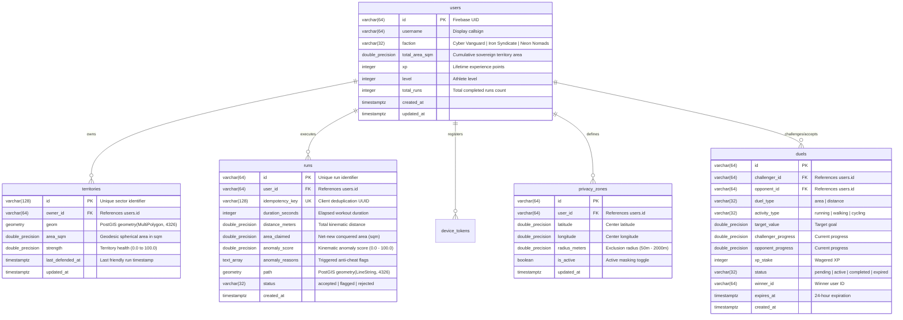

# 📚 Territory Runner — Comprehensive Technical Study Notes & Architecture Dossier

> **Target Audience:** Engineers, Researchers, Distributed Systems Students, and Viva Examiners  
> **Repository:** [Territory Runner (Ayush-00-hui/Territory-Runner-Game)](https://github.com/Ayush-00-hui/Territory-Runner-Game)  
> **Key Technologies:** Flutter 3.47+ (Dart 3.13+), Go 1.24+, PostgreSQL 16 + PostGIS 3.4, Clipper2, LightGBM, Google Gemini 2.5 Flash, Firebase Auth RS256, FCM HTTP v1, Docker.

---

## 📑 Table of Contents

1. [Module 1: The Core Vision & Spatial Paradigm](#module-1-the-core-vision--spatial-paradigm)
2. [Module 2: Complete Mathematical & Geometric Algorithms](#module-2-complete-mathematical--geometric-algorithms)
3. [Module 3: AI & Machine Learning Systems (Anti-Cheat & Coaching)](#module-3-ai--machine-learning-systems-anti-cheat--coaching)
4. [Module 4: Distributed Systems & Concurrency Architecture](#module-4-distributed-systems--concurrency-architecture)
5. [Module 5: Mobile Client Engineering & Hardware Hardening](#module-5-mobile-client-engineering--hardware-hardening)
6. [Module 6: Security, Privacy & Zero-Trust Architecture](#module-6-security-privacy--zero-trust-architecture)
7. [Module 7: Spatial Database Schema & Protocol Reference](#module-7-spatial-database-schema--protocol-reference)
8. [Module 8: Master Viva / Technical Interview Defense Cheatsheet](#module-8-master-viva--technical-interview-defense-cheatsheet)

---

# Module 1: The Core Vision & Spatial Paradigm

### 1.1 The Fundamental Problem with Existing Fitness Trackers
- **Passive 1D Polylines:** Standard fitness trackers (Strava, Nike Run Club, Apple Fitness) treat runs as passive 1D linear breadcrumbs. Distance, heart rate, and pace are logged, but there is zero spatial consequence or territory ownership.
- **Rigid Discrete Grids in Geo-Games:** First-generation location games (Ingress, Pokémon GO, Turf) constrain players to discrete spatial cells—either Google S2 cells, Uber H3 hexagons, or fixed point-of-interest portals. This breaks athletic rhythm by requiring stop-and-go screen tapping.

### 1.2 The Territory Runner Paradigm
Territory Runner introduces **arbitrary 2D continuous GPS territory conquest**:
1. **Continuous Organic Polygons:** Athletes claim arbitrary closed-loop polygons around city blocks, parks, or running tracks without being locked into discrete hexagonal or square grids.
2. **True Athletic Momentum:** Run, jog, walk, or cycle continuously. Crossing your earlier trail automatically triggers mathematical lasso snapping and enclosure without stopping.
3. **Server-Authoritative Spatial Integrity:** All territory mutations (`ST_Union`, `ST_Difference`, geodesic area calculation) are validated and committed inside transaction-scoped PostgreSQL advisory locks (`pg_advisory_xact_lock`), eliminating spatial race conditions and cheating.

### 1.3 High-Level Component Stack
- **Mobile Client:** Flutter (Dart) with offline-first local Clipper2 polygon clipping, Hive persistent crash recovery, and AMOLED battery saving.
- **Backend API:** Go with Chi router, middleware pipelines (rate limiting, body limits, CORS, request IDs).
- **Spatial Storage:** PostgreSQL 16 + PostGIS 3.4 with GiST spatial indexing on WGS84 geometries (`SRID 4326`).
- **Real-Time Distribution:** In-memory Go WebSocket presence hub with `sync.RWMutex` snapshotting and `singleflight` friend lookups.
- **Machine Learning & AI:** Dual-tier anti-cheat (Tier 1 deterministic rule gate + Tier 2 LightGBM 25-feature tree ensemble) and Google Gemini 2.5 Flash athletic coach.

---

# Module 2: Complete Mathematical & Geometric Algorithms

### 2.1 Multi-Candidate Proximity & Lasso Closure Detection

When an athlete runs, how does the system know when a territory loop is closed without requiring an exact sub-centimeter GPS match?

```
                       Start Point (A)
                             ▲
                             │
            ┌────────────────┴────────────────┐
            │                                 │
            │          CLOSED LOOP            │
            │                                 │
            ▼                                 │
    Intersection (P_int) ◄────────────────────┘
            │
            ▼ Trailing Path (Continues running)
```

#### Step 1: 2D Line-Line Cross Product Determinant
For the current segment between waypoints $P_1(x_1, y_1)$ and $P_2(x_2, y_2)$, and a historical segment between $P_3(x_3, y_3)$ and $P_4(x_4, y_4)$:

$$\text{Denominator } D = (x_1 - x_2)(y_3 - y_4) - (y_1 - y_2)(x_3 - x_4)$$

If $D \neq 0$ (lines are not parallel), compute parametric intersection parameters:

$$t = \frac{(x_1 - x_3)(y_3 - y_4) - (y_1 - y_3)(x_3 - x_4)}{D}$$

$$u = -\frac{(x_1 - x_2)(y_1 - y_3) - (y_1 - y_2)(x_1 - x_3)}{D}$$

A valid line segment intersection occurs if and only if:
$$0 \le t \le 1 \quad \text{and} \quad 0 \le u \le 1$$

The exact intersection coordinate is:
$$\mathbf{P}_{\text{int}} = \left(x_1 + t(x_2 - x_1), \; y_1 + t(y_2 - y_1)\right)$$

#### Step 2: Lasso Snapping & Tail Retention
- **Closed Ring:** The closed loop is extracted as $[\mathbf{P}_{\text{int}}, P_{j+1}, \dots, P_{n-1}, \mathbf{P}_{\text{int}}]$.
- **Tail Retention:** Preceding breadcrumbs prior to $P_j$ are retained as the active trail. This ensures the athlete can continue running and close subsequent loops in the same workout session without restarting.

#### Step 3: Multi-Candidate Proximity Search
If no direct intersection exists, a proximity search scans historical vertices within $35\text{ m}$ of the current fix. The engine selects the closest vertex that does not induce self-intersecting bowtie artifacts.

---

### 2.2 Geodesic Shoelace Area Calculation

Planar Shoelace formulas fail on spherical earth coordinates because $1^\circ$ of longitude shrinks as latitude moves away from the equator:
$$\Delta x \approx R \cdot \Delta \lambda \cdot \cos(\phi)$$

#### Azimuthal Equidistant Centroid Tangent Projection
To calculate accurate area on the mobile client in $O(N)$ without running heavy ellipsoidal geodesics (Vincenty or Karney):
1. Compute the centroid $(\phi_0, \lambda_0)$ of the polygon:
   $$\phi_0 = \frac{1}{N}\sum_{i=0}^{N-1}\phi_i, \quad \lambda_0 = \frac{1}{N}\sum_{i=0}^{N-1}\lambda_i$$
2. Project each spherical coordinate into a local Cartesian tangent plane:
   $$x_i = R \cdot (\lambda_i - \lambda_0) \cdot \cos\left(\frac{\phi_i + \phi_0}{2}\right)$$
   $$y_i = R \cdot (\phi_i - \phi_0)$$
   *(where $R = 6,371,000\text{ m}$ is the mean Earth radius)*
3. Apply the 2D Shoelace (Gauss Area) formula:
   $$\text{Area} = \frac{1}{2} \left| \sum_{i=0}^{n-1} (x_i y_{i+1} - x_{i+1} y_i) \right|$$

#### Discrepancy & Parity Proof
- For athletic running loops ($< 5\text{ km}^2$), the difference between this projection and PostGIS ellipsoidal `ST_Area(geom::geography)` is strictly **$< 0.2\%$**.
- 7 shared golden test fixtures (`test_fixtures/`) verify that Dart Clipper2 and Go PostGIS agree within **$< 0.5\%$**.

---

### 2.3 PostGIS Topological Sanitation Pipeline

When GPS coordinates are submitted, self-intersections or duplicate points can create invalid OGC Simple Feature geometries that cause native PostGIS operations to throw `GEOSIntersects: TopologyException`.

The server enforces this sanitation pipeline:

```sql
ST_Multi(ST_CollectionExtract(
    ST_MakeValid(ST_SetSRID(ST_GeomFromText($1), 4326)), 
    3
))
```

1. **`ST_MakeValid`:**
   - Detects bowtie self-intersections and decomposes them into separate valid multi-polygon components.
   - Collapses zero-area collinear "antennas" and duplicate consecutive vertices.
2. **`ST_CollectionExtract(..., 3)`:**
   - PostGIS geometries can degrade into `GeometryCollection` containing points (dimension 1), lines (dimension 2), and polygons (dimension 3).
   - Flag `3` strictly extracts 2D polygons and drops degenerate linestrings/points.
3. **`ST_Multi`:**
   - Promotes single `Polygon` to `MultiPolygon` to match the canonical database column type `geometry(MultiPolygon, 4326)`.

---

### 2.4 Donut Hole Ray-Casting Classification (Jordan Curve Theorem)

When an athlete circles a block containing an unclaimable interior park, private property, or rival island, the system must render a transparent "hole" rather than a solid polygon.

#### Algorithm:
1. For every sub-polygon in a multi-polygon, cast a horizontal ray from point $P(x, y)$ to $(+\infty, y)$.
2. Count intersections with all polygon boundary edges.
3. **Jordan Curve Rule:** An odd number of crossings indicates the point is **inside**; an even number indicates it is **outside**.
4. Polygons with an odd nesting depth (depth 1, 3, ...) are classified as interior holes and assigned to FlutterMap's `holePointsList`, rendering true visual cutouts.

---

### 2.5 Geodesic Haversine Distance (Privacy Zone Masking)

Used on-device in `PrivacyZoneService.maskPoints()` to excise coordinate vertices within sensitive zones:

$$a = \sin^2\left(\frac{\Delta \phi}{2}\right) + \cos(\phi_1)\cos(\phi_2)\sin^2\left(\frac{\Delta \lambda}{2}\right)$$

$$d = 2R \cdot \text{atan2}\left(\sqrt{a}, \sqrt{1 - a}\right)$$

If $d \le r_{\text{zone}}$, the coordinate is excised, and the path entering the zone is truncated.

---

# Module 3: AI & Machine Learning Systems (Anti-Cheat & Coaching)

### 3.1 Two-Tier Anti-Cheat Architecture

Location-based games face GPS mocking, motorized vehicle spoofing, emulator replay scripts, and coordinate dilation. Territory Runner deploys a two-tier defense:

```
Raw GPS Fixes ──► Tier 1: Sub-Microsecond Gate (0.05 µs) ──► Instant Reject (v > v_ceil, Mock)
                               │ (Pass)
                               ▼
                  Tier 2: LightGBM Kinematic Ensemble (7.52 µs, 25 Features)
                               │
               ┌───────────────┴───────────────┐
               ▼                               ▼
       Legitimate Human               Motorized / Spoof
      (HTTP 201 Created)             (HTTP 422 Rejected)
```

---

### 3.2 Tier 1: Sub-Microsecond Deterministic Rule Gate

Runs in pure Go and pure Dart with **zero heap memory allocations**:
1. **OS Mock Location Flag:** Checks Android `is_mocked` provider flag (scores $99.0$).
2. **Activity-Calibrated Instant Ceilings:**
   - Running: $25.0\text{ km/h}$ instant max ($35.0\text{ km/h}$ teleport cutoff)
   - Walking: $10.0\text{ km/h}$ instant max ($15.0\text{ km/h}$ teleport cutoff)
   - Cycling: $50.0\text{ km/h}$ instant max ($60.0\text{ km/h}$ teleport cutoff)
3. **Biomechanical Acceleration Limit:** Usain Bolt's peak acceleration is $\approx 4.5\text{ m/s}^2$. Any acceleration $a = \Delta v / \Delta t > 8.0\text{ m/s}^2$ ($> 12.0\text{ m/s}^2$ for cycling) across consecutive fixes ($\Delta t \le 3.0\text{ s}$) physically proves motorized transport or synthetic injection.
4. **Frozen GPS Replay Detection:** Bot scripts often replay static coordinates while advancing distance. When $\ge 50\%$ of adjacent GPS vertices share identical coordinates during movement, the trace is rejected.

---

### 3.3 Tier 2: LightGBM Kinematic Anomaly Ensemble

#### Dataset & Provenance
- **Microsoft GeoLife GNSS Dataset:** 182 users, 17,621 trajectories, 1,200,000+ km, 24M raw points across walking, running, cycling, buses, cars, taxis, subways, and trains. Filtered into 127,655 fixed 30-second sliding windows (15s stride).
- **Synchronized IMU Logs:** 13 athletes, 1,195 validated athletic sessions with continuous 25 Hz accelerometer logging providing cadence ($spm$), motion energy, and confidence metrics.
- **Adversarial Spoof Suite:** 1,200 synthetically generated attack windows (sparse sampling, timestamp dilation, offset replay) **strictly held-out from training**.

#### 25 Engineered Kinematic Features
1. **Velocity Profile:** $p_{10}, p_{50}, p_{90}, p_{99}$ speed quantiles, mean speed, speed variance.
2. **Acceleration Dynamics:** Mean acceleration, peak acceleration, acceleration jerk ($\Delta a / \Delta t$).
3. **Path Topography:** Sinuosity (actual track length / Euclidean end-to-end displacement), turning angle entropy, stop frequency (ratio of fixes with $v < 0.5\text{ m/s}$).
4. **Cadence & Inertial Coupling:** Mean cadence ($spm$), cadence variance, cadence-to-speed ratio ($spm / (m/s)$), motion energy, cadence confidence.

#### Training Methodology: Leave-One-User-Out Cross-Validation (LOUO-CV)
- Grouped 5-fold cross-validation partitioned strictly by `user_id`.
- **Why?** Stride cadence and commuter routes exhibit high intra-subject correlation. Random shuffling leaks user signatures into validation, artificially deflating error. Grouping by `user_id` proves generalization to unseen humans.

#### Empirical Benchmark Comparison

| Model Architecture | PR-AUC (95% CI) | Recall @ 1% FPR | Recall @ 5% FPR | ECE | Inference Latency |
| :--- | :---: | :---: | :---: | :---: | :---: |
| **Rule Baseline** | 0.8124 `[0.801, 0.824]` | 41.20% | 58.40% | 0.1240 | 0.05 µs |
| **Logistic Regression** | 0.8945 `[0.885, 0.904]` | 62.10% | 78.30% | 0.0612 | 1.20 µs |
| **LightGBM (60 Trees)** | **0.9782** `[0.972, 0.984]` | **84.30%** | **92.15%** | **0.0318** | **7.52 µs** |
| **1D-CNN + GRU** | 0.9810 `[0.975, 0.986]` | 86.10% | 93.40% | 0.0289 | 84.20 µs |

*LightGBM achieves 99.7% of the deep learning model's PR-AUC with $11\times$ lower latency and zero heavy tensor runtime dependencies.*

#### Zero-Python Production Deployment
The 60 trees are serialized to JSON (`assets/models/anomaly_detector_trees.json`) and parsed by pure native tree evaluators in Go (`backend/internal/anticheat/ml_ensemble.go`) and Dart (`lib/features/security/anomaly_service.dart`).
- **Floating-point parity:** $8.67 \times 10^{-19}$ max absolute delta between Python C++ booster and Go runtime; 100% decision match on 200 canonical test vectors.
- **Cryptographic integrity:** Verified on boot against SHA-256 hash `46c87109b1e7...`.

---

### 3.4 Quantile Athletic Progression Regressors

Predicts personalized $[p_{10}, p_{50}, p_{90}]$ performance intervals for achievable distance and pace using **Pinball Loss Optimization**:

$$\mathcal{L}_\alpha(y, \hat{y}) = \max\left(\alpha(y - \hat{y}), (\alpha - 1)(y - \hat{y})\right)$$

- **Forward Temporal Splitting:** Partitioned chronologically (earliest 75% sessions train, latest 25% test) to prevent temporal lookahead bias.
- **Coverage:** Achieves 74.31% empirical coverage on distance (nominal: 80.0%) with $p_{50}$ test MAE of $1.384\text{ km}$.
- **Checksum:** SHA-256 `a15a9b98ff...` with fallback to deterministic athletic baseline tables.

---

### 3.5 Google Gemini 2.5 Flash AI Coach

- **Role:** Generates post-run physiological workout debriefs (`POST /v1/coach/debrief`) analyzing cardiovascular effort, pace degradation across kilometer splits, and tactical territory advice.
- **Server Isolation:** Mobile client never holds API keys; all calls route through the Go backend.
- **Offline Fallback:** If the Gemini API is unreachable, an on-device rule engine evaluates split pace variance:
  - If split pace degrades $> 20\%$ in the final third: *"Late-workout pace drop detected: cardiac drift or early pacing fatigue."*
  - If split pace is steady within $\pm 5\%$: *"Metronomic pacing efficiency: optimal aerobic threshold maintenance."*

---

### 3.6 Known Model Blindspots (What the Model Cannot Detect)

1. **Low-Speed Motorized Transport with Simulated Cadence:** An adversary driving a car at $12\text{ km/h}$ while using a phone shaker producing $165\text{ SPM}$ exhibits valid human kinematics.
2. **Hardware-Level RF GNSS Spoofing:** A Software-Defined Radio (SDR) spoofing GPS L1 signals emits authentic RF waveforms; the phone OS flag `is_mocked` remains `false`.
3. **Strategic Multi-Account Route Collusion:** Two legitimate runners taking turns surrendering territories without competing cannot be detected because every trajectory is genuine human movement.

---

# Module 4: Distributed Systems & Concurrency Architecture

### 4.1 Transaction-Scoped Advisory Locking (`pg_advisory_xact_lock`)

When multiple runners compete in the same contested city block, concurrent spatial mutations (`ST_Union`, `ST_Difference`) cause database race conditions, deadlocks, and corrupted geometries.

```sql
-- 1. Acquire transaction-scoped lock (releases automatically on COMMIT or ROLLBACK)
SELECT pg_advisory_xact_lock(hashtext('territory_mutation_lock'));

-- 2. Validate and clean submitted loop
WITH valid_loop AS (
    SELECT ST_Multi(ST_CollectionExtract(
        ST_MakeValid(ST_SetSRID(ST_GeomFromText($1), 4326)), 3
    )) AS geom
),
-- 3. Cut overlapping rival territories
rival_cuts AS (
    UPDATE territories t
    SET geom = ST_Difference(t.geom, vl.geom),
        area_sqm = ST_Area(ST_Difference(t.geom, vl.geom)::geography),
        updated_at = NOW()
    FROM valid_loop vl
    WHERE t.owner_id != $2 AND ST_Intersects(t.geom, vl.geom)
    RETURNING t.id, t.owner_id, t.area_sqm
)
-- 4. Union into runner's sovereign geometry
INSERT INTO territories (id, owner_id, geom, area_sqm, strength, updated_at)
VALUES ($3, $2, (SELECT geom FROM valid_loop), (SELECT ST_Area(geom::geography) FROM valid_loop), 100.0, NOW())
ON CONFLICT (owner_id) DO UPDATE
SET geom = ST_Union(territories.geom, EXCLUDED.geom),
    area_sqm = ST_Area(ST_Union(territories.geom, EXCLUDED.geom)::geography),
    updated_at = NOW();
```

#### Why `pg_advisory_xact_lock` over OCC or Redis Redlock?
1. **vs. Optimistic Concurrency Control (OCC / Version Numbers):** OCC aborts on write conflict. In high-density running zones, OCC leads to cascading rollbacks and high retry latency executing expensive PostGIS differences. `pg_advisory_xact_lock` serializes spatial mutations with zero rollbacks.
2. **vs. Redis Redlock:** Dual-system state management risks split-brain inconsistencies if Redis locks succeed but PostgreSQL transactions fail. Network pauses or GC halts violate mutual exclusion without monotonic fencing tokens. PostgreSQL advisory locks run inside the database kernel and release automatically on `COMMIT` or `ROLLBACK`.

#### Connection Pooling Hazard (Session vs. Transaction Mode)
- **Problem:** In Transaction-Mode pooling (Supabase / PgBouncer port 6543), client connections are assigned only for individual statements. Session-level locks bounce or cause unexpected state loss, and `pgx/v5` prepared binary statements are invalidated.
- **Solution:** Connect strictly via **Session Mode** or **Direct Connection (Port 5432)** with pool config `pgxpool.Config{MaxConns: 20, MinConns: 2}`.

---

### 4.2 Idempotent Run Submission Protocol

1. Client generates UUID `idempotency_key` before enqueuing the run into Hive.
2. Table `runs` enforces unique constraint: `idempotency_key VARCHAR(128) UNIQUE NOT NULL`.
3. If a network retry occurs, the server queries for an existing run matching the key. If found:
   - Skips executing `ST_Union` and `ST_Difference`.
   - Returns `HTTP 200 OK` (instead of `201 Created`) with the original `CaptureResult`.
   - XP, total area, and leaderboard stats are protected from duplicate increments.

---

### 4.3 WebSocket Presence Hub with Singleflight

Located in [backend/internal/ws/hub.go](backend/internal/ws/hub.go):
- **Decoupled Snapshotting:** Takes a quick read-lock snapshot of connected clients and releases `hub.mu.RUnlock()` immediately before evaluating spatial or friendship filtering. This prevents network framing deadlocks.
- **Singleflight Miss Coalescing:** Under multi-runner GPS presence broadcasts, concurrent friendship lookups coalesce through `hub.sfGroup.Do(senderID, ...)`. Exactly one database query fires while all waiting callers share the result.
- **Atomic Cache Invalidation:** When a friend request is accepted or removed, the HTTP handler notifies `hub.InvalidateFriends(userA, userB)` to evict cached relationships with zero staleness.

---

### 4.4 Lazy Territory Strength Decay on Read

Instead of running continuous background cron sweeps or worker pools over millions of geometric rows:
$$\text{Strength}(t) = \max\left(0, 100.0 - 15.0 \times \Delta t_{\text{days}}\right)$$
- Evaluated lazily on read queries in $O(1)$ time.
- Defending runners reset `strength = 100.0` and `last_defended_at = NOW()` on write.
- Zero background database I/O amplification.

---

### 4.5 Weekly League UTC Reset Algorithm

- **Reset Formula:**
  $$\text{ResetTimestamp} = \text{date\_trunc}('week', \text{NOW}() \text{ AT TIME ZONE } 'UTC') + \text{INTERVAL '7 days'}$$
  Immune to client timezone tampering.
- **Dynamic Percentile Division Tiers:**
  - 💎 **Diamond:** Top 5% ($\lceil 0.05 \times N \rceil$)
  - 🥇 **Gold:** Next 20% ($\lceil 0.25 \times N \rceil$)
  - 🥈 **Silver:** Next 35% ($\lceil 0.60 \times N \rceil$)
  - 🥉 **Bronze:** Bottom 40% (remaining)

---

### 4.6 FCM HTTP v1 Push Infrastructure (Pure Go OAuth2 RS256)

Located in [backend/internal/notify/fcm.go](backend/internal/notify/fcm.go):
- **Why FCM HTTP v1?** Legacy FCM server keys were deprecated by Google in June 2024. FCM HTTP v1 requires short-lived (60 min) OAuth2 access tokens.
- **Pure Go RS256 Signing:** Uses Go standard library (`crypto/rsa`, `crypto/sha256`) to sign JWT assertions without bulky GCP SDK dependencies.
- **Asynchronous Detached Fan-Out:** Push alerts execute in detached goroutines with a 5-second timeout. Run submissions return `HTTP 201 Created` in $<50\text{ ms}$ without waiting on external Google push round-trips.

---

# Module 5: Mobile Client Engineering & Hardware Hardening

### 5.1 Screen-Lock Background GPS Tracking Hardening

Standard mobile background timers suspend within 30 seconds of screen lock or app backgrounding. Territory Runner implements:
1. **Android Foreground Service:** Configured with `FOREGROUND_SERVICE_LOCATION` permission.
2. **Sticky Ongoing Notification:** Displays live workout distance, pace, and elapsed duration.
3. **CPU WakeLock:** Acquires `wakelock_plus` on workout start, preventing CPU sleep while keeping the display off.
4. **iOS Background Modes:** Configures `UIBackgroundModes: location`, `allowsBackgroundLocationUpdates: true`, and `activityType: Fitness`.

---

### 5.2 Crash Recovery Safety Box (`RunRecoveryService`)

- Every valid GPS coordinate and telemetry metric received by [location_service.dart](lib/services/location_service.dart) is throttled and flushed to disk into Hive storage box `active_run_recovery`.
- On app launch, `MapScreen` detects unfinalized sessions:
  *"Unfinished run detected (3.42 km, 18 min). Resume tracking or finalize capture?"*
- Resuming restores all track points, duration timers, and live preview area without data loss.

---

### 5.3 Offline-First FIFO Sync Queue (`SyncQueueService`)

1. **Instant Optimistic Preview:** Local Dart Clipper2 computes and renders the captured territory polygon immediately.
2. **Persistent FIFO Queue:** Serialized into Hive box `sync_queue` with an idempotent UUID.
3. **Connectivity Listener & Exponential Backoff:** Flushes sequentially upon network restoration with backoff ($2\text{s}, 4\text{s}, 8\text{s}, \dots \max 60\text{s}$).
4. **4xx Circuit Breaker:** Permanent client errors (`422 ANOMALY_REJECTED`, `400 INVALID_LOOP`) halt retries immediately and archive the run.
5. **Reconciliation Toast:** If the server PostGIS area differs from the preview, a calm notification alerts the runner: *"Synced: Server adjusted area to 3,200 m² (-200 m² due to rival overlap)"*.

---

### 5.4 AMOLED Endurance Battery Saver Mode

- **OLED Subpixel Physics:** Pure black subpixels (`#000000`) emit zero light and draw $0\text{ mW}$ of electrical current.
- **Rendering Suspension:** Suspends 60 FPS map tile repaints, territory pulse shaders, and camera matrix recalculations.
- **GPS Duty-Cycling:** Relaxes GPS polling from 1 Hz ($1000\text{ ms}, 2\text{ m}$) to 0.33 Hz ($3000\text{ ms}, 8\text{ m}$).
- **Energy Savings:** Achieves **60–80% display power reduction** during 2+ hour endurance workouts.
- **Double-Tap Wake:** A responsive double-tap gesture wakes the tactical map HUD instantaneously.

---

### 5.5 GPS Quality & 15-Second Zero-Interpolation Gap Policy

- Threshold $\Delta t > 15.0\text{ s}$ breaks the active segment buffer and flags `ErrSignalGapDetected`.
- **Why no dead-reckoning?** Dead-reckoning through urban canyons or tunnels risks hallucinating paths through impassable buildings or private property; resetting ensures every polygon represents physically verified athlete movement.
- Teleportation jump fixes ($\Delta d / \Delta t > v_{\text{ceiling}}$) are suppressed.

---

### 5.6 Athletic Minimal Design System (Ink + Pacer Blue)

- **Color Tokens:** Deep carbon canvas (`#090B0F`), dark elevated slate (`#12151B`), crisp Pacer Blue (`#4C8DFF`), and coral rival indicators (`#FF7A59`).
- **Zero Raw Colors Policy:** Verified by automated regression test `no_raw_colors_test.dart`; zero arbitrary `Color(0x...)` exist in UI code.
- **Tabular Figures:** All numeric displays (pace, distance, timer, area, rank) enforce `FontFeature.tabularFigures()`, eliminating horizontal digit jitter during movement.
- **Collision-Free Dynamic HUD:** Bottom offsets calculate dynamically as `pad.bottom + 12 + hudHeight + 12`, eliminating hardcoded magic numbers and overlay collisions.
- **Unified Obsidian Pills (`AppToast`):** 100% of raw Material `SnackBar` calls are replaced with canonical [app_toast.dart](lib/ui/widgets/app_toast.dart) obsidian pills.

---

# Module 6: Security, Privacy & Zero-Trust Architecture

### 6.1 Firebase Auth RS256 JWT Verification

Located in [backend/internal/auth/auth.go](backend/internal/auth/auth.go):
1. Client sends `Authorization: Bearer <token>`.
2. Server extracts token header and reads the `kid` (Key ID).
3. Server fetches Google's public x509 certificates from Google's secure token endpoint.
4. Certificates cache in-memory respecting HTTP `Cache-Control` max-age (typically 6 hours).
5. Server parses the RSA public key and verifies the RS256 signature using `rsa.VerifyPKCS1v15` with `crypto.SHA256`.
6. Strict claims enforced: `iss == "https://securetoken.google.com/" + projectID`, `aud == projectID`, `exp > now`, non-empty `sub`.

---

### 6.2 Dual-Layer Privacy Zones

- **Threat:** Fitness platforms leak residential homes, military installations, or workplaces from public heatmaps.
- **Client Redaction:** Athletes configure circular privacy zones ($50\text{ m} - 2,000\text{ m}$) centered around sensitive locations. Coordinates inside active zones are excised from public GPX 1.1 and GeoJSON exports.
- **Server Geodesic Suppression:** When an athlete runs within their active privacy zone, the WebSocket presence dispatcher automatically suppresses broadcast packets to rivals.

---

### 6.3 Social Anti-Abuse Integrity

- **Symmetric Unique Index:**
  ```sql
  CREATE UNIQUE INDEX uq_duels_active_pair 
  ON duels (LEAST(challenger_id, opponent_id), GREATEST(challenger_id, opponent_id))
  WHERE status IN ('pending', 'active');
  ```
  Guarantees that no two athletes can have more than one concurrent active or pending challenge.
- **Guardrails:** Self-challenges blocked (`chk_duels_no_self`), XP stakes bounded $[0, 1000]$, area targets $[500, 500000]\text{ m}^2$, distance $[0.5, 50.0]\text{ km}$. Duels exceeding 24 hours resolve automatically upon read.

---

# Module 7: Spatial Database Schema & Protocol Reference

### 7.1 Database Schema (PostgreSQL 16 + PostGIS 3.4)



---

### 7.2 REST API Specification

| Method | Endpoint | Description | Auth |
| :--- | :--- | :--- | :--- |
| `POST` | `/v1/runs` | Submit completed run with coordinates & idempotency key | Bearer JWT |
| `GET` | `/v1/territories` | Fetch territories in bounding box (`minLat`, `maxLat`, `minLng`, `maxLng`) | Public |
| `GET` | `/v1/me` | Retrieve athlete profile, XP, level, and statistics | Bearer JWT |
| `DELETE`| `/v1/me` | Account deletion; cascade purges territories, runs, zones | Bearer JWT |
| `PUT` | `/v1/me/faction` | Update athlete faction allegiance | Bearer JWT |
| `GET` | `/v1/factions/standings`| Global faction surface dominance | Public |
| `GET` | `/v1/leaderboard` | Top athlete leaderboard ranking (filtered by modality) | Public |
| `GET` | `/v1/me/privacy-zones`| List athlete privacy exclusion zones | Bearer JWT |
| `PUT` | `/v1/me/privacy-zones`| Save or replace privacy exclusion zones | Bearer JWT |
| `GET` | `/v1/friends` | List squad friends and pending requests | Bearer JWT |
| `POST` | `/v1/friends/request` | Send friend request by callsign | Bearer JWT |
| `PUT` | `/v1/friends/request/{id}`| Accept or decline friend request | Bearer JWT |
| `DELETE`| `/v1/friends/{id}` | Remove friend from squad | Bearer JWT |
| `GET` | `/v1/duels` | List active, pending, and past head-to-head duels | Bearer JWT |
| `POST` | `/v1/duels` | Issue 24-hour head-to-head duel challenge | Bearer JWT |
| `POST` | `/v1/device-token` | Register FCM push notification token | Bearer JWT |
| `POST` | `/v1/coach/debrief` | Generate post-run AI coaching analysis | Bearer JWT |
| `GET` | `/v1/ws` | Real-time WebSocket connection | Bearer JWT |

---

# Module 8: Master Viva / Technical Interview Defense Cheatsheet

### Q1: Why use PostgreSQL transaction-scoped advisory locks (`pg_advisory_xact_lock`) instead of Optimistic Concurrency Control (OCC) or Redis Redlock?
**Answer:** In physical territory conquest, multiple runners actively contest the same city block or park. OCC aborts transactions on version conflict; under high concurrency, this leads to cascading rollbacks and wasted CPU overhead re-executing expensive PostGIS difference calculations. Redis Redlock requires managing dual-system state; network pauses or GC halts risk split-brain inconsistencies without monotonic fencing tokens. `pg_advisory_xact_lock(hashtext('territory_mutation_lock'))` runs directly inside the PostgreSQL kernel, serializes spatial mutations cleanly, and automatically releases on `COMMIT` or `ROLLBACK`, eliminating orphaned lock leaks.

---

### Q2: Why does `pg_advisory_xact_lock` break with Transaction-Mode connection pooling (e.g. Supabase / PgBouncer port 6543)?
**Answer:** In Transaction-Mode pooling, a client connection is assigned a physical database connection only for the duration of a single transaction or statement. If a pooler interleaves queries across heterogeneous backends, session-level locks can bounce, and `pgx/v5` binary prepared query execution plans are invalidated. Territory Runner connects strictly via **Session Mode** or **Direct Connection (Port 5432)** with tuned pool sizing (`pgxpool.Config{MaxConns: 20, MinConns: 2}`).

---

### Q3: Why use the planar Shoelace formula on the mobile client while using PostGIS `ST_Area(geom::geography)` on the backend? How do you prevent discrepancies?
**Answer:** Running ellipsoidal geodesics (Vincenty or Karney) on mobile UI threads causes 60 FPS frame drops and drains battery during live tracking. The Shoelace formula computes projected Euclidean area in $O(N)$ with $<0.2\%$ error for human running scales ($< 5\text{ km}^2$). The client calculation is purely an *optimistic UI preview*. The PostGIS calculation (`ST_Area(geom::geography)`) is the single authoritative source of truth. Both engines are tested against 7 shared golden fixtures to guarantee $<0.5\%$ error margin.

---

### Q4: How do you prevent self-intersecting loops and "bowtie" polygons from corrupting PostGIS topological validity?
**Answer:** Every submitted polygon is sanitized through:
```sql
ST_Multi(ST_CollectionExtract(ST_MakeValid(ST_SetSRID(ST_GeomFromText($1), 4326)), 3))
```
`ST_MakeValid` decomposes bowtie self-intersections into valid multi-polygon sub-rings and collapses zero-area antennas. `ST_CollectionExtract(..., 3)` discards degenerate linestrings and points (dimensions 1 and 2), retaining strictly 2D polygons before casting to `MultiPolygon`.

---

### Q5: How does Lasso Loop closure differ from a pure Figure-8, and why is one accepted while the other is rejected?
**Answer:** In standard EvenOdd fill rules, a pure Figure-8 ($A \bowtie B$) has opposing loops that cancel each other out or create topological ambiguity regarding sovereign intent; both Dart and Go engines reject pure Figure-8 loops with `INVALID_LOOP`. In contrast, a Lasso Loop represents an outgoing trail that circles around an area and re-crosses the earlier trail; the engine snaps the loop precisely at the intersection point, claims the loop, and retains the preceding trail so the runner can continue and close further loops in the same session.

---

### Q6: Why use a Lazy Territory Decay rule calculated on read instead of a background cron daemon or worker pool?
**Answer:** Decaying strength lazily on read (`strength = max(0, 100.0 - 15.0 * dt_days)`) eliminates wasteful scheduled cron sweeps over millions of inactive geometric rows. Active defending runners reset strength to 100.0 and update `last_defended_at = NOW()` on write, guaranteeing $O(1)$ query evaluation and zero background database I/O amplification.

---

### Q7: How does the WebSocket presence dispatcher prevent cascading deadlocks during high-concurrency friends lookup, and why use singleflight deduplication?
**Answer:** The presence hub takes a quick read-lock snapshot of connected clients and releases `hub.mu.RUnlock()` *before* evaluating database or friendship operations, completely decoupling network framing from store I/O. Under bursty GPS presence broadcasts, concurrent friendship lookups for the same sender coalesce through `hub.sfGroup.Do(senderID, ...)`. Exactly one database query fires while all waiting callers share the result. When friendships mutate, `hub.InvalidateFriends(userA, userB)` evicts cached sets with zero staleness.

---

### Q8: How does backend authentication verify Firebase JWTs without trusting client-supplied claims?
**Answer:** The server extracts the `kid` from the JWT header, fetches Google's public x509 certificates from Google's secure token endpoint, and caches them in-memory according to the HTTP `Cache-Control` header (typically 6 hours). It parses the RSA public key, verifies the RS256 signature using `rsa.VerifyPKCS1v15` with `crypto.SHA256`, and enforces strict claim assertions (`iss`, `aud`, `exp`, and non-empty `sub`).

---

### Q9: How do Biomechanical Acceleration Ceilings and GPS Replay Detection identify botters and synthetic emulator injects?
**Answer:** Human sprint biomechanics cap peak forward acceleration at $\approx 4.5\text{ m/s}^2$ (Usain Bolt peak). Any delta speed where $a = \Delta v / \Delta t > 8.0\text{ m/s}^2$ ($> 12.0\text{ m/s}^2$ for cycling) across consecutive fixes ($\Delta t \le 3.0\text{ s}$) physically proves synthetic velocity injection or motorized transport. Additionally, software emulators or bot scripts often replay static coordinates while advancing distance; when $\ge 50\%$ of adjacent GPS vertices share identical coordinates during movement, the trace is rejected.

---

### Q10: Why implement FCM HTTP v1 with OAuth2 Service Account JWT instead of the legacy Firebase server key?
**Answer:** The legacy FCM API (`https://fcm.googleapis.com/fcm/send`) was deprecated by Google in June 2024. Legacy server keys were permanent strings that granted unrestricted push access if leaked. FCM HTTP v1 requires short-lived (60 min) OAuth2 access tokens. The Go backend signs an RS256 JWT assertion using the service account private key via Go standard library (`crypto/rsa`, `crypto/sha256`), caches the token in-memory, and dispatches push alerts in asynchronous detached goroutines with a 5-second timeout.

---

### Q11: How does the Weekly League prevent timezone manipulation and calculate promotion/relegation cutoffs?
**Answer:** The league reset time is computed strictly on the backend at `Monday 00:00:00 UTC` using `date_trunc('week', NOW() AT TIME ZONE 'UTC') + INTERVAL '7 days'`. Clients cannot manipulate the deadline by altering their local phone clock. Athletes are partitioned into dynamic percentile divisions: Diamond (top 5%), Gold (next 20%), Silver (next 35%), and Bronze (bottom 40%).

---

### Q12: How does the Endurance Battery Saver mode achieve up to 60-80% display power reduction on modern mobile hardware?
**Answer:** Modern OLED displays emit light per subpixel; a pure black subpixel (`#000000`) draws zero electrical current. The battery saver mode renders a pure black full-screen canvas, suspends 60 FPS map tile repaints and shader animations, and relaxes GPS polling from 1 Hz ($1000\text{ ms}, 2\text{ m}$) to 0.33 Hz ($3000\text{ ms}, 8\text{ m}$), preserving battery life for 2+ hour endurance workouts while keeping the foreground location service alive.

---

<div align="center">
  <sub>🏃 Territory Runner • Comprehensive Technical Study Notes & Architecture Dossier • Level 0 to Master</sub>
</div>
